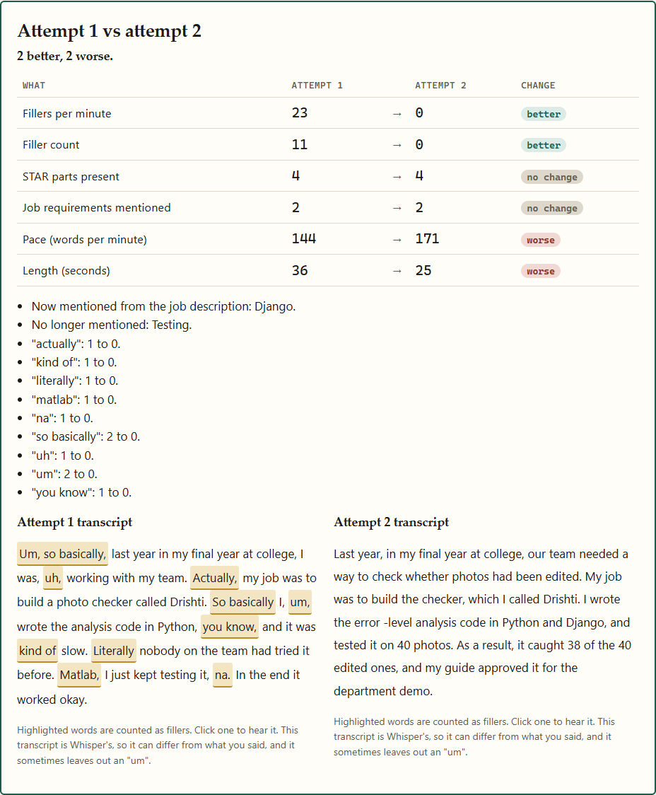

# VoxIQ

Practise interview answers and see exactly what improved.

I built VoxIQ to practise for campus placements. You upload your résumé and paste a job description. A local language model writes questions from your own projects ("You list Drishti AI. How did you measure its accuracy?"), and you answer out loud. VoxIQ transcribes the answer and gives you a checklist: pace, filler words, STAR structure, job description coverage and length. Each line shows its reason and the evidence from your transcript. Answer the same question again and it puts attempt 1 and attempt 2 side by side, with what changed.

It is not a hiring predictor and it gives no overall grade. Everything runs on your machine.



## Run it

Needs Python 3.10+, and [Ollama](https://ollama.com) for the questions and rewrites. A GPU helps but is not required.

```bash
python -m venv .venv
.venv/Scripts/pip install -r requirements.txt     # Windows; use .venv/bin/pip elsewhere
ollama pull qwen2.5:1.5b                          # about 1 GB
.venv/Scripts/python main.py                      # http://127.0.0.1:8000
```

The first answer you analyse downloads Whisper `small.en` (about 500 MB) and loads it, so it is slow once. On a CPU-only machine set `VOXIQ_WHISPER_DEVICE=cpu`. Settings are environment variables, listed in `.env.example` (Whisper model, Ollama model, limits, data folder).

Tests: `.venv/Scripts/python -m pytest tests` (61 tests, no models needed; Whisper and the LLM are replaced by fakes).

If Ollama is not running the app still works: résumé questions fall back to templates built from your project names and skills, and are labelled as templates. Rewrites need Ollama.

## What each check does

| Check | How it is measured | Target (my choice, shown in the UI) |
|---|---|---|
| Pace | words divided by time from first word to last | 120 to 160 words per minute |
| Filler words | rule-based detector on Whisper's timestamped words; click a highlighted filler to hear it | at most 3 per minute |
| STAR | each sentence is matched against cue phrases for Situation, Task, Action, Result; the cue is shown | all 4 present |
| Job description | skills found in the JD (a vocabulary in `voxiq/skills.py`, plus repeated keywords) versus skills you said | 60% mentioned |
| Length | seconds of audio | 60 to 120 seconds |

The targets come from common coaching advice. I did not measure them against interview outcomes.

Fillers include um, uh, like, you know, basically, so basically, actually, literally, kind of, sort of, matlab, "na?" and "right?" at the end of a sentence. Words that are often real words (actually, like, kind of, literally, you know) count only in filler positions: "Actually, I changed it" counts, "what actually happened" does not. The list is in `voxiq/fillers_default.json`; copy it and point `VOXIQ_FILLERS_FILE` at your version to add words or switch rules off. The examples are in `tests/test_fillers.py`.

Attempts and their recordings are stored in `data/` (SQLite plus WAV files). Delete one from the page, or delete the folder.

## Speech recognition accuracy

Word error rate on the first 40 utterances of LibriSpeech test-clean (read English, clean audio), faster-whisper on the RTX 5050, beam size 5, text lower-cased and stripped of punctuation:

| Model | WER |
|---|---|
| tiny.en (the old version) | 4.5% |
| base.en | 4.3% |
| small.en (now the default) | 4.0% |

Reproduce with `python eval/fetch_librispeech.py` then `python eval/wer.py`. This is a small sample of clean American-read speech. **I have not measured Indian-accented English**, spontaneous speech or a noisy laptop microphone, and Whisper is known to do worse on them. The gain from tiny to small is small on this set; I kept small because it was cheap on the GPU.

## Limits

- Not a hiring predictor. The checks say how an answer is built and delivered, not whether it is good.
- STAR detection uses cue phrases I wrote. It misses answers that do not use them and can credit a sentence that has the cue but not the substance. I have not measured its accuracy.
- The filler detector is heuristic and tested on examples, not on a labelled recording set. Whisper also drops some "um" and "uh" even with a prompt that encourages keeping them, so the count can be too low.
- Questions from a 1.5B model can be generic or slightly wrong. Some come from templates, and each question says which. Skip the bad ones.
- Résumé parsing expects ordinary headings (Projects, Skills). Scanned PDFs are not supported (no OCR).
- The suggested rewrite is a model's guess. It is told to use only what you said and to leave placeholders, but it can still add things. It is shown as a suggestion, never as your words.
- Accents and microphones: untested, see above.

## Licences of what it uses

faster-whisper (MIT), Whisper weights (MIT), CTranslate2 (MIT), FastAPI (MIT), pypdf (BSD), python-docx (MIT), PyTorch (BSD), Ollama (MIT). The Qwen2.5 1.5B model is Apache 2.0. Nothing AGPL or GPL.

## Layout

`voxiq/` holds the code (`fillers.py`, `star.py`, `jd.py`, `scoring.py`, `compare.py`, `questions.py`, `resume.py`, `suggest.py`, `store.py`, `app.py`). `frontend/` is plain HTML, CSS and JS with no CDN. `eval/` has the WER scripts. `tools/screenshots.py` regenerates `docs/screenshots/` with Playwright, Edge and a fake microphone fed from `samples/attempt1.wav`. Those sample answers are spoken by the Windows text-to-speech voice, not a person. `_old/` keeps the previous version, including the generated dataset and its random forest.
